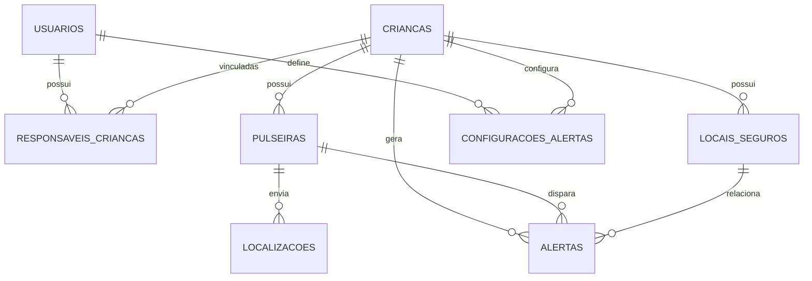

# Pulseira Localizadora Infantil

## Objetivo
Este repositório contém uma proposta completa de sistema para TCC com backend em Node.js, banco MySQL e aplicativo Flutter integrado.

## Estrutura
- backend/
- flutter_app/

## Banco de dados
O arquivo SQL principal está em:
- backend/database/schema.sql

Dados de demonstração em:
- backend/database/seed.sql

## Backend
Consulte [backend/README.md](backend/README.md) para instruções completas de instalação e execução.

## Flutter
A aplicação Flutter foi iniciada em [flutter_app](flutter_app) e inclui:
- Login e cadastro
- Tela inicial com resumo de crianças, pulseiras e alertas
- Cadastro e edição de pulseiras vinculadas a perfis infantis
- Acompanhamento das últimas localizações recebidas em mapa OpenStreetMap
- Atualização automática do mapa a cada 15 segundos; a pulseira precisa enviar coordenadas à API para mostrar uma posição real
- Listagem de alertas
- Configuração do endpoint da API via variável de ambiente

## Requisitos de hardware
- MySQL local em execução.
- Emulador Android: use 10.0.2.2 no lugar do localhost.
- Dispositivo físico: use o IP do computador host na mesma rede.

## Configuração da API no Flutter
- Flutter Web e iOS usam `http://localhost:3005` por padrão.
- O emulador Android usa `http://10.0.2.2:3005`.
- Para um dispositivo físico Android, informe o endereço IPv4 do computador que executa o backend:

```bash
cd flutter_app
flutter run --dart-define=API_BASE_URL=http://192.168.0.10:3005
```

Substitua `192.168.0.10` pelo IP do computador na rede local. Durante o desenvolvimento, a API permite origens localhost do Flutter Web; em produção, configure origens explícitas em `CORS_ORIGIN`. Confirme também que o backend e o MySQL estão em execução e que a porta 3005 está acessível. Para distribuir o aplicativo, configure a API com HTTPS.

## Diagrama ER


## Observações
O projeto foi estruturado para funcionar com dados reais e também com modo de demonstração, em que o app identifica claramente a origem dos dados simulados.
"# Projeto_TCC_Zeloos" 
